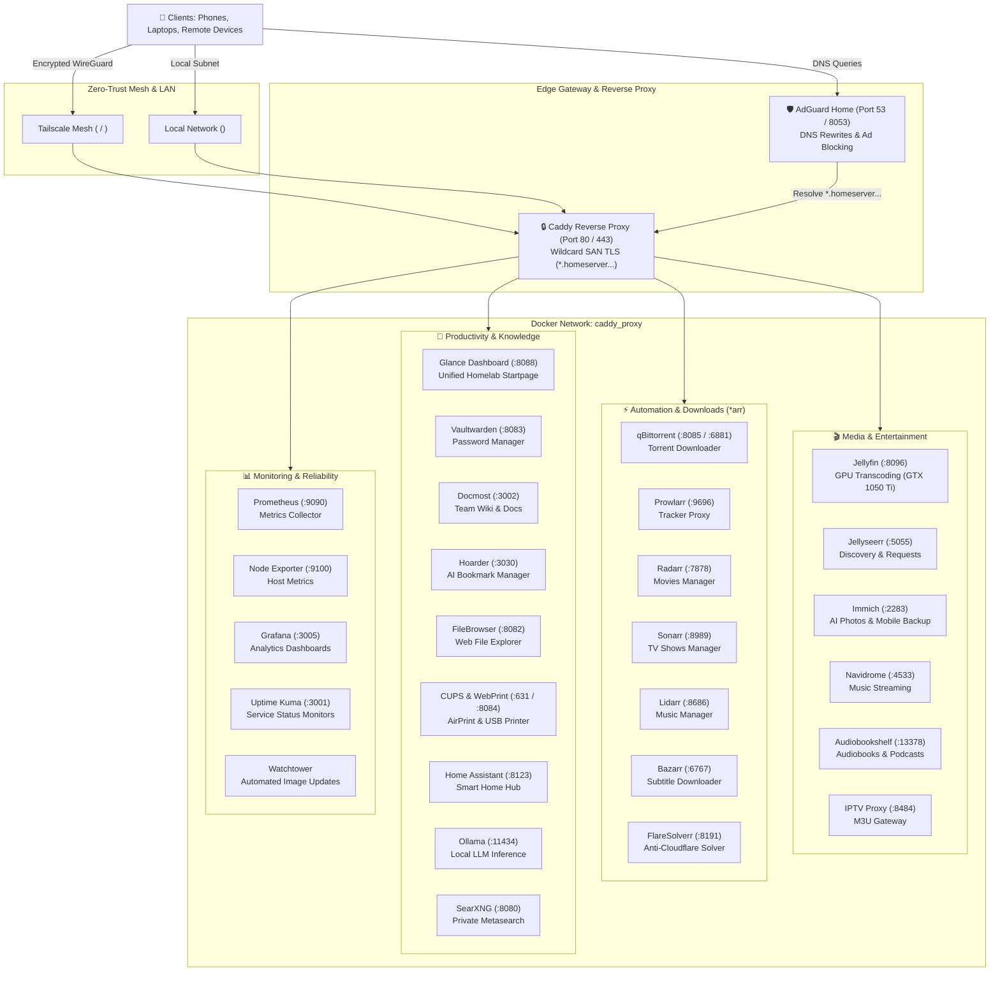

# 🏠 Autonomous Production Homeserver

> **A declarative, 100% containerized, resilient self-hosted private cloud running 24/7 on Arch Linux with Caddy TLS reverse proxying, Tailscale zero-trust mesh networking, and automated hardware acceleration.**

[](https://www.docker.com/)
[](https://caddyserver.com/)
[](https://tailscale.com/)
[](LICENSE)

---

## ⚡ 1-Command Instant Setup

Deploy the entire stack from scratch on any machine running Arch Linux, Debian, or Ubuntu:

```bash
git clone git@github.com:Blianokoji/homeserver.git ~/homeserver && cd ~/homeserver && ./install.sh
```

Or execute directly via `curl`:

```bash
curl -fsSL https://raw.githubusercontent.com/Blianokoji/homeserver/main/install.sh | bash
```

---

## 🏛️ System Architecture



---

## 📁 Repository Structure

```
homeserver/
├── install.sh                       # 1-command complete installer and orchestrator
├── README.md                        # Master architectural documentation
├── .gitignore                       # Protects databases, credentials, and TLS private keys
│
├── compose/                         # Declarative Docker Compose Stacks
│   ├── services/                    # Master App Stack (Glance, Media, *arrs, Monitoring)
│   ├── caddy/                       # Caddy v2 Reverse Proxy & Modular conf.d
│   ├── immich/                      # Immich Photos, Valkey, pgvector PostgreSQL
│   ├── docmost/                     # Docmost Knowledge Base, DB & Redis
│   ├── hoarder/                     # Hoarder Bookmark Manager, Meilisearch & Chrome
│   ├── ollama/                      # Ollama Local LLMs (NVIDIA GPU Passthrough)
│   ├── searxng/                     # SearXNG Private Search Engine
│   ├── cups/                        # CUPS, AirPrint, Epson Driver & WebPrint Portal
│   └── iptv-proxy/                  # Custom Python Live TV Proxy & Buffer
│
├── configs/                         # Version-Controlled Application Configurations
│   ├── glance/glance.yml            # Homelab startpage widgets & RSS feeds
│   ├── prometheus/prometheus.yml    # Scrape targets & metrics retention
│   ├── searxng/settings.yml         # Safe search, enabled engines & UI preferences
│   ├── jellyseerr/                  # Custom Jellyseerr patches & entrypoints
│   └── portexplain/services.json    # Port catalog & conflict prevention database
│
├── system/                          # Host OS, Kernel, Display & Network Configurations
│   ├── scripts/
│   │   ├── generate_certs.sh        # 10-Year Local CA & SAN Wildcard TLS Generator
│   │   ├── setup_drm_virtual_layer.sh # Kernel VKMS & EDID injection script
│   │   └── portexplain              # Intelligent network audit CLI tool
│   ├── firmware/edid_1080p.bin      # GTX 1050 Ti HDMI-A-1 headless forcing EDID
│   ├── udev/85-sunshine-input.rules # Virtual input permissions for Sunshine
│   ├── modprobe.d/vkms.conf         # Virtual Kernel Mode Setting configuration
│   └── modules-load.d/vkms.conf     # Auto-load vkms on system boot
│
└── docs/                            # Deep-Dive Homelab Reference Manuals
    ├── HOMESERVER_GUIDE.md          # Complete master operations manual
    ├── SELF_HOSTED_APPS.md          # Exhaustive service registry & persistent paths
    ├── PORTEXPLAIN_REGISTRY.md      # Port master audit log & collision rules
    ├── REVERSE_PROXY_ARCHITECTURE.md# Caddy reverse proxy topology & DNS map
    └── TECHHUT_2025_UPGRADE_PLAN.md # Long-term hardware & infrastructure roadmap
```

---

## 🌐 Master Service Catalog & Port Registry

All services are accessible on the LAN (`<lan-ip>`), over Tailscale (`<tailscale-ip>`), or via internal HTTPS subdomains:

| Service | Port | Category | HTTPS Gateway Domain | Persistent Host Path |
| :--- | :--- | :--- | :--- | :--- |
| **Glance Dashboard** | `8088` | Portal | `https://glance.<tailscale-domain>` | `/mnt/storage/AppData/glance` |
| **Jellyfin Streaming** | `8096` | Media | `https://jellyfin.<tailscale-domain>` | `/mnt/storage/AppData/jellyfin` |
| **Jellyseerr Requests**| `5055` | Media | `https://jellyseerr.<tailscale-domain>` | `/mnt/storage/AppData/jellyseerr` |
| **Immich Photos** | `2283` | Media | `https://immich.<tailscale-domain>` | `/mnt/storage/Media/Immich` |
| **Navidrome Music** | `4533` | Audio | `https://navidrome.<tailscale-domain>` | `/mnt/storage/AppData/navidrome` |
| **Audiobookshelf** | `13378`| Audio | `https://audiobookshelf.<tailscale-domain>` | `/mnt/storage/AppData/audiobookshelf` |
| **IPTV Proxy** | `8484` | Video | `https://iptv.<tailscale-domain>` | `/mnt/storage/AppData/iptv-proxy` |
| **qBittorrent** | `8085` | Downloads | `https://qbittorrent.<tailscale-domain>` | `/mnt/storage/AppData/qbittorrent` |
| **Prowlarr** | `9696` | Indexer | `https://prowlarr.<tailscale-domain>` | `/mnt/storage/AppData/prowlarr` |
| **Radarr** | `7878` | Automation| `https://radarr.<tailscale-domain>` | `/mnt/storage/AppData/radarr` |
| **Sonarr** | `8989` | Automation| `https://sonarr.<tailscale-domain>` | `/mnt/storage/AppData/sonarr` |
| **Lidarr** | `8686` | Automation| `https://lidarr.<tailscale-domain>` | `/mnt/storage/AppData/lidarr` |
| **Bazarr** | `6767` | Subtitles | `https://bazarr.<tailscale-domain>` | `/mnt/storage/AppData/bazarr` |
| **FlareSolverr** | `8191` | Utilities | — | Docker internal |
| **Vaultwarden** | `8083` | Security | `https://vaultwarden.<tailscale-domain>` | `/mnt/storage/AppData/vaultwarden` |
| **FileBrowser** | `8082` | Files | `https://filebrowser.<tailscale-domain>` | `/mnt/storage/AppData/filebrowser` |
| **Docmost** | `3002` | Wiki | `https://docmost.<tailscale-domain>` | `/mnt/storage/AppData/docmost` |
| **Hoarder** | `3030` | Bookmarks | `https://hoarder.<tailscale-domain>` | `/mnt/storage/AppData/hoarder` |
| **Home Assistant** | `8123` | IoT | `https://homeassistant.<tailscale-domain>` | `/mnt/storage/AppData/homeassistant` |
| **AdGuard Home** | `8053` | DNS / Net | `https://adguard.<tailscale-domain>` | `/mnt/storage/AppData/adguardhome` |
| **CUPS WebPrint** | `8084` | Printing | `https://print.<tailscale-domain>` | `/mnt/storage/AppData/cups` |
| **Ollama LLM** | `11434`| AI | — | `/mnt/storage/AppData/ollama` |
| **SearXNG** | `8080` | Search | `https://searxng.<tailscale-domain>` | `/mnt/storage/AppData/searxng` |
| **Uptime Kuma** | `3001` | Monitor | `https://uptime.<tailscale-domain>` | `/mnt/storage/AppData/uptime-kuma` |
| **Prometheus** | `9090` | Metrics | — | `/mnt/storage/AppData/prometheus` |
| **Node Exporter** | `9100` | Metrics | — | Host `/proc`, `/sys` |
| **Grafana** | `3005` | Dashboards| `https://grafana.<tailscale-domain>` | `/mnt/storage/AppData/grafana` |
| **Watchtower** | — | Updates | — | `/var/run/docker.sock` |

---

## 💾 Storage Architecture Invariants

All persistent data strictly obeys the following directory taxonomy on `/mnt/storage`:

* **`/mnt/storage/AppData/<service>/`**: Persistent container volumes, databases, configurations, and cache files.
* **`/mnt/storage/Media/<category>/`**: High-capacity media libraries partitioned into `Movies`, `TV`, `Music`, `Audiobooks`, `Podcasts`, `Photos`, and `Immich`.
* **`/mnt/storage/Downloads/`**: Central staging location for torrents, temporary downloads, and completed unpacks.
* **`/mnt/storage/Backups/`**: Disaster recovery archives, database snapshots, and migration tarballs.

---

## 🔒 Security & TLS Policy

1. **Zero Open Ports on Router**: Public Internet exposure is strictly **0**. No port forwarding exists on the WAN router.
2. **Tailscale Layer 4 Isolation**: Remote access is strictly authenticated via Tailscale WireGuard. Media users are bounded by Tailscale Grants to prevent administrative access.
3. **Caddy SAN Wildcard TLS**: All internal HTTP endpoints are automatically proxied with HTTPS using an internal 10-year Root CA and a multi-domain SAN wildcard certificate:
   * `*.<tailscale-domain>`
   * `*.homeserver`
   * `*.home.arpa`
   * `*.lan`

---

## 🛠️ Management & Operational Commands

```bash
# 1. Audit ports, listening sockets, and registry hit lists
portexplain

# 2. Check live status of all Docker stacks
docker ps --format "table {{.Names}}\t{{.Status}}\t{{.Ports}}"

# 3. Reload Caddy reverse proxy without downtime
docker exec caddy caddy reload --config /etc/caddy/Caddyfile

# 4. View real-time logs for any container
docker logs -f --tail 100 <container_name>

# 5. Restart an entire compose stack
cd /mnt/storage/AppData/<service> && docker compose restart
```

---

## 📜 License

Created and maintained with ❤️ by [Blessen Eby (Blianokoji)](https://github.com/Blianokoji). Released under the MIT License.
